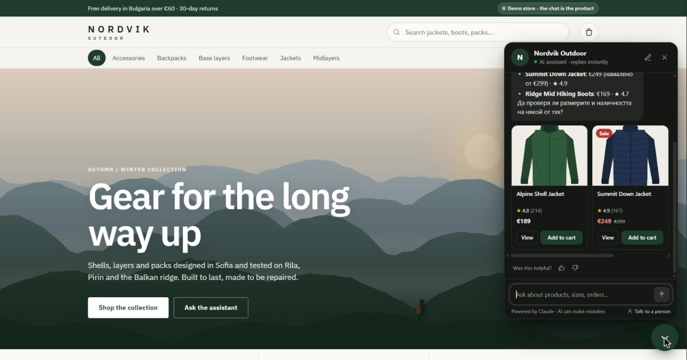
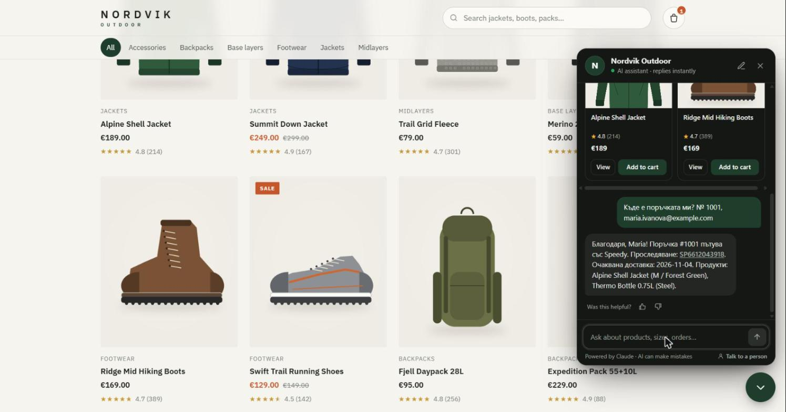
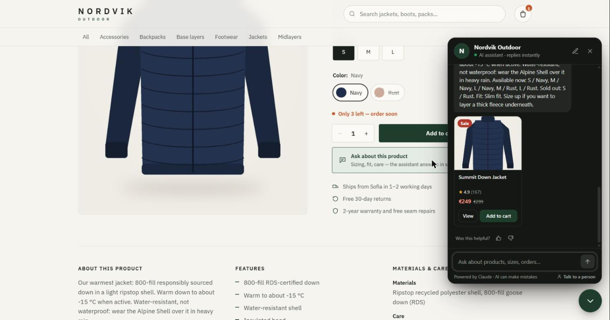
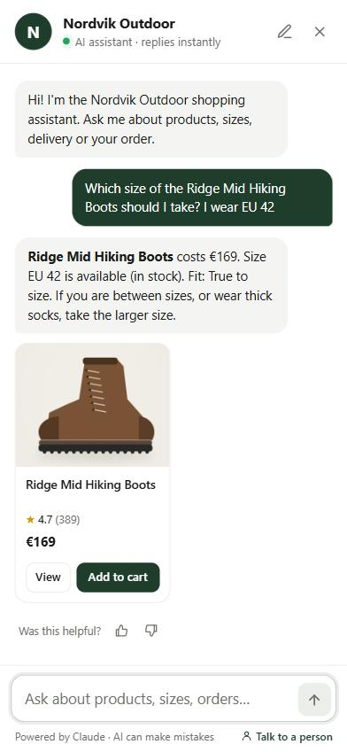
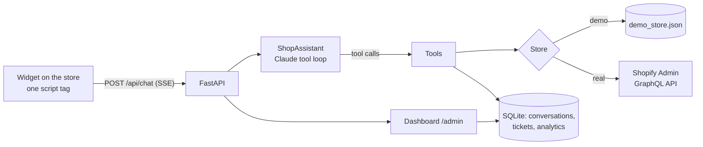
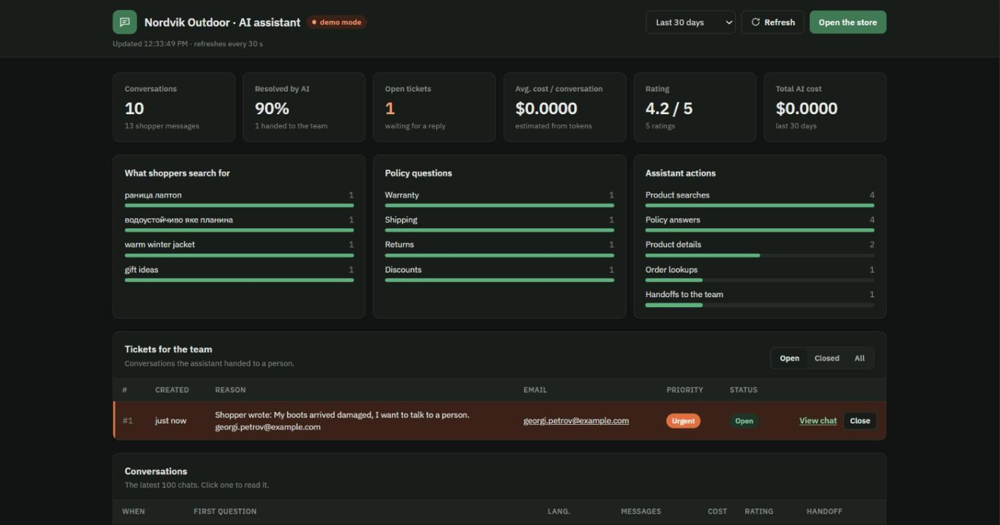
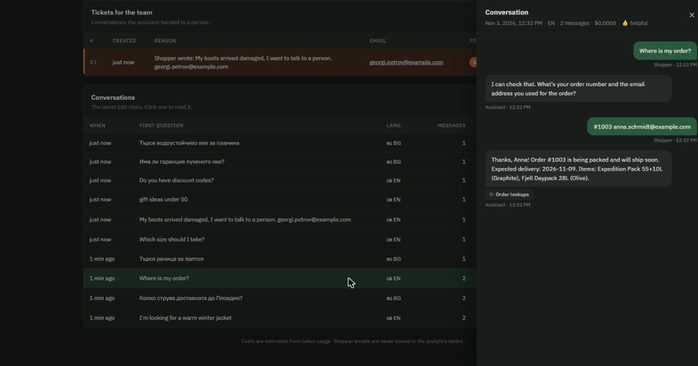

# Shopify AI Shopping Assistant

An AI assistant that sits on a Shopify store and answers shoppers the way a good shop assistant would: it finds products, checks sizes and stock, explains delivery and returns, tracks orders, and passes the conversation to a person when it should. Every fact comes from the store itself (the catalog, the policies and the orders), so it doesn't invent prices, stock or promises.

It is one `<script>` tag on the store. The team gets a dashboard with every conversation, the tickets the assistant opened for them, what shoppers search for, and what the AI costs.

Built on **Claude tool use** (Anthropic Python SDK, streaming), **FastAPI**, **SQLite** and the **Shopify Admin GraphQL API**, with a dependency-free widget. It runs fully offline in **demo mode** (no API key, no Shopify store) on a fictional outdoor shop, Nordvik Outdoor. (The demo store's product illustrations are drawn by `data/make_images.py`; a real store shows its own Shopify photos.)



## What it does for a store

| Shopper asks | What the assistant does |
|---|---|
| "I need a waterproof jacket for hiking, under €200" | Searches the catalog, recommends up to 3 products with a reason each, and shows product cards with price, rating, stock and **Add to cart** |
| "Is the Alpine Shell available in M? Does it run small?" | Reads the product: every size and colour with live stock ("only 2 left"), the fit note and materials. On a product page it knows which product the shopper is looking at |
| "How much is delivery? Can I return it?" | Answers from the store's own shipping, returns, payment, warranty and size-guide policies, and says so when a policy doesn't cover the question |
| "Where is my order?" | Asks for the order number **and** the email, then gives the status, the courier's tracking link and the expected delivery date |
| "My boots arrived damaged" / "I want a person" | Opens a ticket for the team with a one-line summary, the shopper's email and the priority, and tells the shopper when they'll hear back |

It replies in the shopper's language (tested in English and Bulgarian), even though the catalog is in English.

| Order tracking | Product page: "which size?" | On a phone |
|---|---|---|
|  |  |  |

## Why it can be trusted on a real store

- **Grounded answers.** The system prompt forbids stating any price, stock level, delivery time or policy detail that a tool didn't return in this conversation. Product cards are built from the tool results, not from the model's text, so a card can never show a made-up price.
- **Order privacy.** An order is shown only when the number *and* the email match, and "wrong email" looks exactly like "no such order", so order numbers can't be probed. Lookups are capped at 5 per conversation. Emails are masked in the analytics table.
- **Read-only.** The Shopify app needs only read scopes, and its access token is renewed every 24 hours. The assistant can't change orders, refund or create discounts; anything like that becomes a ticket for a person.
- **Prompt injection.** Shopper messages and tool results are treated as data. The model is told to ignore requests to change its rules or reveal them, and to stay on the store's topics.
- **Validated tool calls.** Every tool input is checked before it runs (types, allowed values, email format); a bad call returns an error the model can recover from. A tool call cut off by the token limit is never executed.
- **Cost and abuse limits.** A daily budget for the whole store, a budget and a turn limit per conversation, a per-IP rate limit and a 1,000-character message limit. The system prompt and tools are prompt-cached, so repeat requests cost less.
- **Refusals.** Server-side refusal fallbacks are on (`fallbacks: "default"`); a declined turn is dropped from the history instead of poisoning the conversation.

## How it works



1. The widget sends the shopper's message and the page they're on.
2. `ShopAssistant` streams a Claude request with five tools. When Claude calls a tool, the app runs it against the store and sends the result back, until Claude answers. The answer streams to the widget word by word, with status lines ("Checking sizes and stock") while tools run.
3. The products the answer names become cards. The full API history (with thinking blocks and tool calls) is saved append-only, so the next message continues the same conversation.

### The tools

| Tool | What it reads |
|---|---|
| `search_products` | Catalog search with optional category, max price and in-stock filter |
| `get_product` | Description, features, materials, care, fit, and every variant with its stock |
| `get_store_policy` | Shipping, returns, payment, warranty, size guide, contact, discounts |
| `lookup_order` | Status, items, tracking and delivery date, only with a matching email |
| `handoff_to_human` | Opens a ticket for the team (the only tool that writes) |

## The dashboard



`/admin` shows the conversations of the last 7, 30 or 90 days: how many the AI resolved without a person, open tickets, cost per conversation, shopper ratings, what shoppers search for, which policies they ask about, and every transcript with the tools each answer used. Tickets can be closed from there. Set `ADMIN_TOKEN` to protect it.



## Run it

```bash
python -m venv .venv && .venv/Scripts/activate      # macOS/Linux: source .venv/bin/activate
pip install -r requirements.txt
uvicorn web.app:create_app --factory --port 8000
```

Open http://localhost:8000 for the demo store and http://localhost:8000/admin for the dashboard. Without `ANTHROPIC_API_KEY` it runs in **demo mode**: the same tools, store, cards, tickets and dashboard, with simple keyword rules in place of Claude. Add the key to `.env` (copy `.env.example`) for the real assistant.

With Docker: `docker build -t shop-assistant . && docker run -p 8000:8000 --env-file .env shop-assistant`.

## Connect a real Shopify store

1. In the [Shopify Dev Dashboard](https://dev.shopify.com/dashboard/), create an app (**Apps → Create app**). Leave it not embedded, give it the scopes `read_products`, `read_inventory`, `read_orders` and `read_legal_policies`, **release** the version and **install** it on the store (the store must be in the same Shopify organization). Copy the **Client ID** and **Client secret** from the app's Settings.
2. Set `SHOPIFY_STORE_DOMAIN=your-store.myshopify.com`, `SHOPIFY_CLIENT_ID`, `SHOPIFY_CLIENT_SECRET`, `ANTHROPIC_API_KEY`, `ALLOWED_ORIGINS=https://your-store.com` and `ADMIN_TOKEN` in `.env`. The app exchanges the client ID and secret for an Admin API token (Shopify's client credentials grant), keeps it for its 24 hours and renews it on its own. Check the connection with `python -m assistant.check_shopify`, which prints the shop, its policies and a few products without using Claude. Then deploy the app (any container host: Azure Container Apps, Fly.io, Render...).

   An older admin-created custom app (made before 2026) still works: set `SHOPIFY_ADMIN_TOKEN` to its `shpat_` token instead.
3. Put answers that have no Shopify policy page (warranty, size guide, discounts) in [`config/faq.md`](config/faq.md).
4. Add the widget to the theme: **Online Store → Themes → Edit code → `theme.liquid`**, just before `</body>`:

```html
<script src="https://YOUR-ASSISTANT-HOST/widget.js" defer
        data-color="#1f3d2b" data-title="Your Store" data-lang="auto"></script>
```

On a Shopify storefront the widget's **Add to cart** button uses Shopify's own `/cart/add.js`, so the item lands in the real cart.

### Configuration

| Variable | Default | |
|---|---|---|
| `ANTHROPIC_API_KEY` | – | Without it, demo mode |
| `CLAUDE_MODEL` | `claude-opus-5-5` | `claude-sonnet-5-5` costs half |
| `CLAUDE_EFFORT` | `low` | Chat answers don't need deep thinking; raise it if answers feel shallow |
| `SHOPIFY_STORE_DOMAIN` | – | Empty: the demo store |
| `SHOPIFY_CLIENT_ID`, `SHOPIFY_CLIENT_SECRET` | – | The Dev Dashboard app's credentials |
| `SHOPIFY_ADMIN_TOKEN` | – | Instead of the two above, for a pre-2026 custom app |
| `SHOPIFY_API_VERSION` | `2026-10` | |
| `FAQ_PATH` | `config/faq.md` | Extra knowledge in Markdown, one `##` section per topic |
| `STORE_ABOUT` | – | One line about the store for the assistant |
| `ALLOWED_ORIGINS` | – | The store's domains (CORS for the widget) |
| `ADMIN_TOKEN` | – | Protects `/admin` and its API |
| `DAILY_BUDGET_USD` / `CONVERSATION_BUDGET_USD` | `5` / `0.50` | Spending limits |
| `MAX_TURNS` / `RATE_LIMIT_PER_MINUTE` | `40` / `12` | Abuse limits |

## Tests

```bash
pip install -r requirements-dev.txt
pytest
```

28 offline tests: catalog search (including Bulgarian words), stock labels and order privacy; tool input validation, the order-lookup cap and one ticket per conversation; the tool loop with a scripted Claude (streaming events, product cards, the thinking block and tool result sent back unchanged, append-only history, prompt caching and fallbacks in the request, refusals and cut-off tool calls); the Shopify client against a fake Admin API (the client credentials token exchange, reuse and renewal, search, variants, policies with FAQ fallback, orders, 401 and GraphQL errors); and the web API (SSE chat, product-page context, rate limit, budgets, the dashboard, the admin token, CSP and CORS). CI runs them on Python 3.11–3.13 and smoke-tests the Docker image.

## Project layout

```
assistant/
  agent.py     the Claude tool loop, system prompt, cost
  tools.py     tool definitions, input validation, execution
  catalog.py   DemoStore and ShopifyStore (Admin GraphQL)
  storage.py   conversations, tickets, analytics (SQLite)
  demo.py      demo mode: keyword rules in place of Claude
web/
  app.py       FastAPI: chat (SSE), dashboard API, demo storefront
  static/      widget.js/.css, the demo store, the dashboard
data/          the demo store's data and its image generator
config/faq.md  extra knowledge for a real store
```
