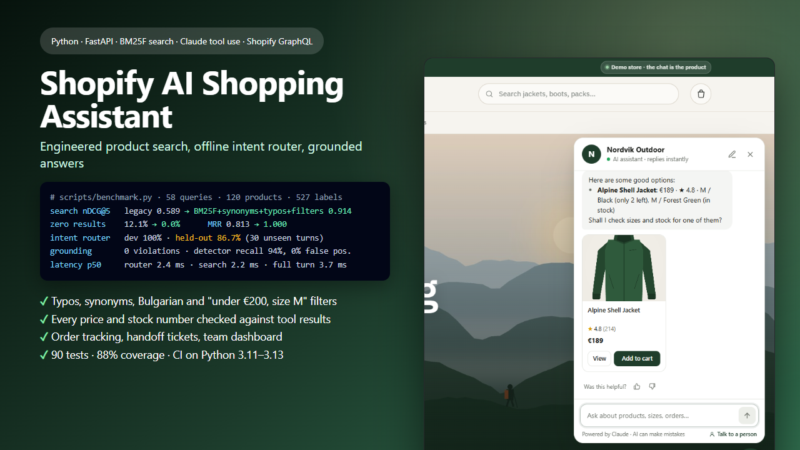
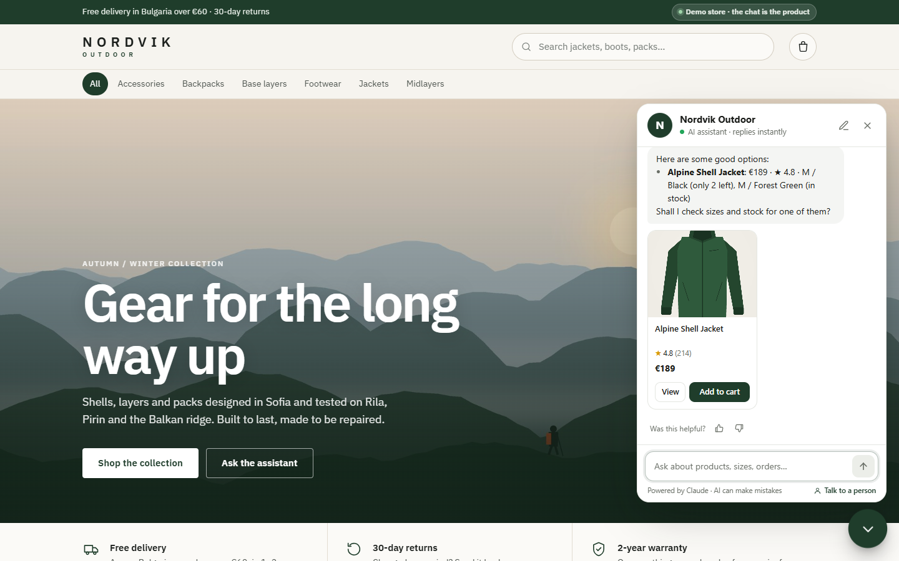
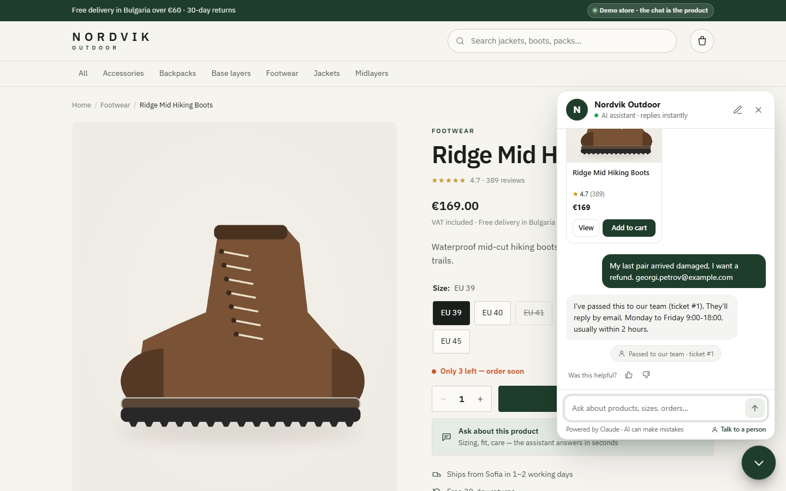
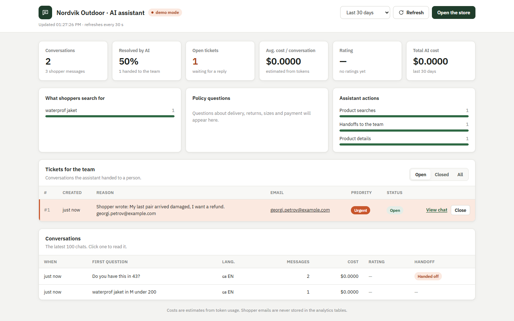
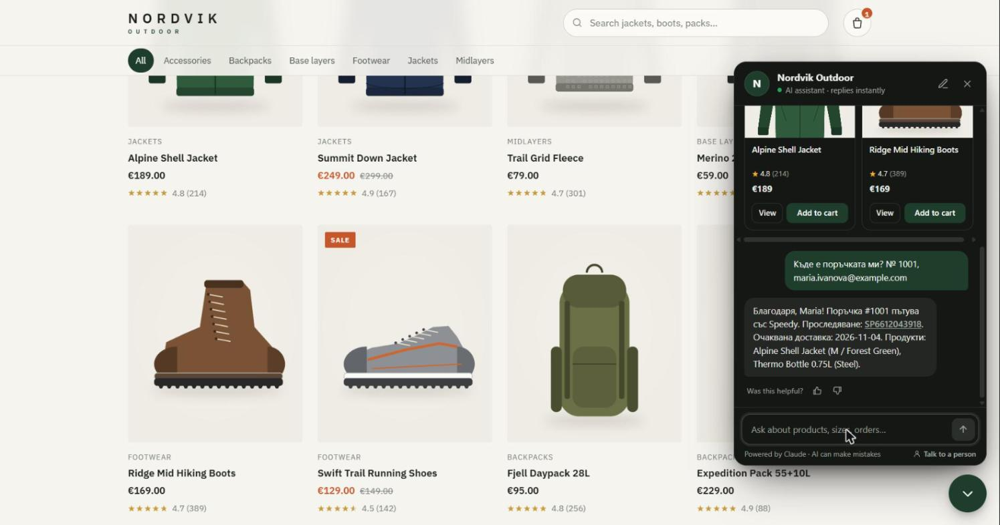
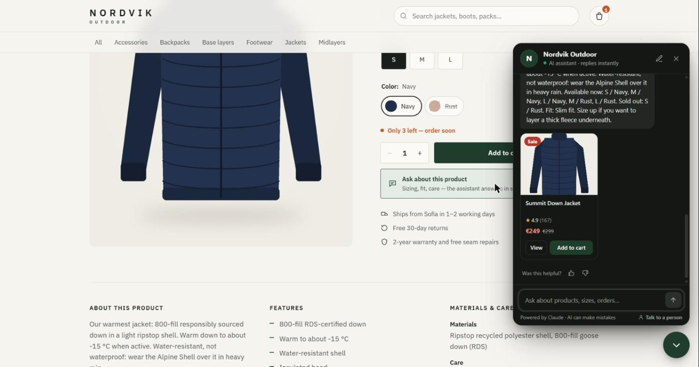
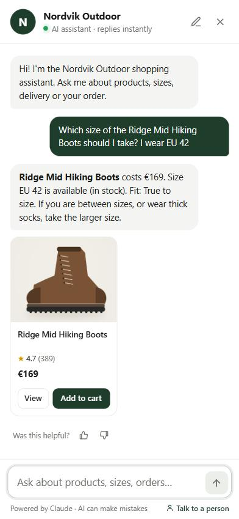
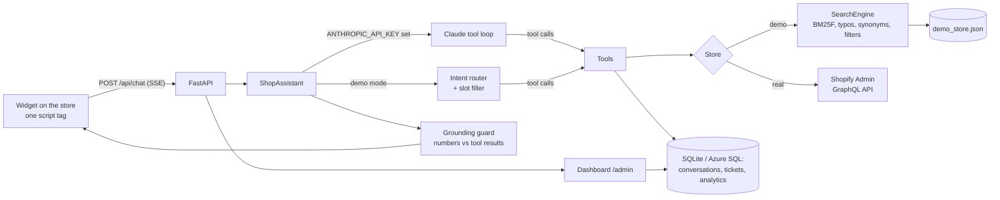

# Shopify AI Shopping Assistant

An AI assistant that sits on a Shopify store and answers shoppers the way a good shop assistant would: it finds products, checks sizes and stock, explains delivery and returns, tracks orders, and passes the conversation to a person when it should. Every fact comes from the store itself (the catalog, the policies and the orders), and a grounding guard checks every number in every answer against the tool results before the shopper keeps it.

It is one `<script>` tag on the store. The team gets a dashboard with every conversation, the tickets the assistant opened for them, what shoppers search for, and what the AI costs.

Built on **Claude tool use** (Anthropic Python SDK, streaming), **FastAPI**, **SQLite** and the **Shopify Admin GraphQL API**, with a dependency-free widget. Product search is its own engineered component (BM25F, typo tolerance, synonyms, Bulgarian, filters parsed from the query), and it runs fully offline in **demo mode** (no API key, no Shopify store) with a deterministic intent router on a fictional outdoor shop, Nordvik Outdoor.



## Features

| Shopper asks | What the assistant does |
|---|---|
| "waterprof jaket in M under 200" | Fixes the typos, reads `size=M` and `max_price=200` out of the query, ranks with BM25F and keeps only products that have an M in stock under €200. Product cards show price, rating, stock and **Add to cart** |
| "Is the Alpine Shell available in M? Does it run small?" | Reads the product: every size and colour with live stock ("only 2 left"), the fit note and materials. On a product page it knows which product the shopper is looking at |
| "How much is delivery? Can I return it?" | Answers from the store's own shipping, returns, payment, warranty and size-guide policies, and says so when a policy doesn't cover the question |
| "Where is my order?" | Asks for the order number **and** the email, then gives the status, the courier's tracking link and the expected delivery date |
| "My boots arrived damaged, I want a refund" / "I want a person" | Opens a ticket for the team with a one-line summary, the shopper's email and the priority (damage and refunds are urgent), and tells the shopper when they'll hear back |

It replies in the shopper's language (tested in English and Bulgarian), even though the catalog is in English.

| Search with typos and filters | Damaged item: handoff with a ticket | The team dashboard |
|---|---|---|
|  |  |  |

| Order tracking | Product page: "which size?" | On a phone |
|---|---|---|
|  |  |  |

### Product search (`assistant/search.py`)

- **BM25F** over title, type, tags, category, description and variant options, with field weights; a **coverage cut** drops products that match less than 60% of the query's meaning-bearing terms.
- **Synonyms and Bulgarian**: "raincoat" finds shells, "яке" finds jackets, "раница" finds backpacks.
- **Typo tolerance**: a SymSpell-style delete index with optimal string alignment distance (1 edit for short words, 2 for long), plus merging of split compounds ("back pack").
- **Filters parsed from the query**: price ("under 200", "до 100 лв", "between 50 and 80"), size ("in M", "size 42"), colour and "in stock". Size and colour are checked at **variant level**, so "red fleece in L" doesn't return a fleece whose only L is blue or sold out.

### Intent router and slot filler (`assistant/router.py`)

A deterministic, offline router scores seven intents (product search, product info, policy, order status, handoff, greeting, other) from cue lists in English and Bulgarian, with a priority tie-break, and fills slots: order number, email, product, policy topic, size, colour, price. A dialogue state remembers the pending question, so an order number in one message and the email in the next complete one order lookup. Action words (refund, cancel, damaged, broken) push a turn to a person even when an order number is present. In demo mode the router drives the tools; with a key, Claude plans and the router is not used.

### Grounding guard (`assistant/grounding.py`)

After every answer (Claude or demo), the guard extracts each price, stock count, duration, percentage and plain number, and checks it against the numbers in this conversation's tool results and the shopper's own messages (with currency and decimal normalisation; SKUs and order numbers are not mistaken for prices). An answer with an ungrounded number has those sentences removed and replaced with a safe line, the widget's streamed text is replaced, and the violation is logged for the dashboard.

## Architecture



1. The widget sends the shopper's message and the page they're on.
2. `ShopAssistant` streams a Claude request with five tools (or asks the router in demo mode). Each tool call runs against the store and the result goes back, until there is an answer. The answer streams to the widget word by word, with status lines ("Checking sizes and stock") while tools run.
3. The grounding guard checks the finished answer; the products it names become cards built from the tool results, not from the model's text. The full API history (with thinking blocks and tool calls) is saved append-only.

### The tools

| Tool | What it reads |
|---|---|
| `search_products` | Catalog search with optional category, min/max price, size, colour and in-stock filter |
| `get_product` | Description, features, materials, care, fit, and every variant with its stock |
| `get_store_policy` | Shipping, returns, payment, warranty, size guide, contact, discounts |
| `lookup_order` | Status, items, tracking and delivery date, only with a matching email |
| `handoff_to_human` | Opens a ticket for the team (the only tool that writes) |

## Benchmark

`python scripts/benchmark.py` measures everything offline and writes [`examples/benchmark.json`](examples/benchmark.json) and [`examples/benchmark.md`](examples/benchmark.md). These numbers are from the run on 2026-11-20 (Windows, Python 3.12.3).

**Search**: 58 queries in six groups against a 120-product evaluation catalog (24 product types, seeded generator `scripts/build_eval_catalog.py`), 527 graded relevance labels (2 = right type, attributes and filters; 1 = right type only, or a related type with the attributes). The "legacy" row is the keyword scorer this project had before.

| System | nDCG@5 | Recall@5 | MRR | Precision of shown top 5 | Zero results |
|---|---:|---:|---:|---:|---:|
| legacy keyword scorer (before) | 0.589 | 0.566 | 0.813 | 0.812 | 12.1% |
| BM25F only | 0.570 | 0.558 | 0.680 | 0.772 | 24.1% |
| + coverage cut | 0.429 | 0.392 | 0.560 | 0.915 | 43.1% |
| + synonyms & BG translations | 0.633 | 0.630 | 0.699 | 0.927 | 27.6% |
| + typo tolerance | 0.761 | 0.754 | 0.837 | 0.935 | 13.8% |
| **+ parsed filters (full, shipped)** | **0.914** | **0.891** | **1.000** | **0.965** | **0.0%** |
| full, without the coverage cut | 0.939 | 0.943 | 1.000 | 0.928 | 0.0% |

nDCG@5 of the full system by group: plain 0.920, synonym 0.878, typo 0.933, Bulgarian 0.882, filters 0.968, mixed 0.853 (the legacy scorer: 0.765, 0.627, 0.232, 0.366, 0.608, 0.835).

**Conversations** (demo mode: router + tools + templated answers, scored turn by turn):

| | Dev set | Held-out set |
|---|---:|---:|
| Conversations / turns | 67 / 78 | 28 / 30 |
| Intent accuracy | 100.0% | 86.7% |
| Tool choice / exact tool call (tool + args) | 100.0% / 100.0% | 86.7% / 86.7% |
| Answer checks passed | 57/57 | 9/13 |
| Handoff precision / recall | 1.00 / 1.00 | 1.00 / 0.67 |
| Handoff priority correct | 100% | 100% |
| Numbers checked by the grounding guard | 232 | 67 |
| Ungrounded numbers in final answers | 0 | 0 |

The router alone on single turns: 100% on 57 dev turns, 88.5% on 26 held-out turns.

**Grounding guard as a detector**: each answer from both sets had one price, stock count, duration or percentage changed to a value no tool returned. The guard caught **94%** of 66 perturbed answers (price 45/47, duration 15/17, stock 1/1, percent 1/1) and flagged **0%** of the 108 untouched answers.

**Latency** (p50 / p95, on a busy laptop, so treat as upper bounds): router 2.41 / 5.34 ms; search on the 12-product demo store 0.47 / 1.16 ms; search on 120 products 2.19 / 5.36 ms; a full demo-mode turn including the SQLite write 3.71 / 7.16 ms; index build for 120 products 26.2 ms.

**Claude mode**: not measured. It needs paid API calls and this benchmark runs fully offline.

## Quick start

```bash
python -m venv .venv && .venv/Scripts/activate      # macOS/Linux: source .venv/bin/activate
pip install -r requirements.txt
uvicorn web.app:create_app --factory --port 8000
```

Open http://localhost:8000 for the demo store and http://localhost:8000/admin for the dashboard. Without `ANTHROPIC_API_KEY` it runs in **demo mode**: the same tools, store, search, cards, tickets, grounding guard and dashboard, with the router in place of Claude. Add the key to `.env` (copy `.env.example`) for the real assistant.

With Docker (multi-stage image, non-root user, health check, read-only filesystem, the database on a volume):

```bash
docker compose up --build
```

Reproduce the evaluation:

```bash
pip install -r requirements-dev.txt
python scripts/build_eval_catalog.py   # regenerates data/eval_catalog.json and eval/search_queries.json (deterministic)
python scripts/benchmark.py            # add --quick for fewer latency repetitions
```

## Connect a real Shopify store

1. In the [Shopify Dev Dashboard](https://dev.shopify.com/dashboard/), create an app (**Apps → Create app**). Leave it not embedded, give it the scopes `read_products`, `read_inventory`, `read_orders` and `read_legal_policies`, **release** the version and **install** it on the store (the store must be in the same Shopify organization). Copy the **Client ID** and **Client secret** from the app's Settings.
2. Set `SHOPIFY_STORE_DOMAIN=your-store.myshopify.com`, `SHOPIFY_CLIENT_ID`, `SHOPIFY_CLIENT_SECRET`, `ANTHROPIC_API_KEY`, `ALLOWED_ORIGINS=https://your-store.com` and `ADMIN_TOKEN` in `.env`. The app exchanges the client ID and secret for an Admin API token (Shopify's client credentials grant), keeps it for its 24 hours and renews it on its own. Check the connection with `python -m assistant.check_shopify`, which prints the shop, its policies and a few products without using Claude. Then deploy the app (any container host: Azure Container Apps, Fly.io, Render...).

   An older admin-created custom app (made before 2026) still works: set `SHOPIFY_ADMIN_TOKEN` to its `shpat_` token instead.
3. Put answers that have no Shopify policy page (warranty, size guide, discounts) in [`config/faq.md`](config/faq.md).
4. Add the widget to the theme: **Online Store → Themes → Edit code → `theme.liquid`**, just before `</body>`:

```html
<script src="https://YOUR-ASSISTANT-HOST/widget.js" defer
        data-color="#1f3d2b" data-title="Your Store" data-lang="auto"></script>
```

On a Shopify storefront the widget's **Add to cart** button uses Shopify's own `/cart/add.js`, so the item lands in the real cart.

### Deploy to Azure

[`infra/deploy.ps1`](infra/deploy.ps1) deploys everything with one command ([`infra/main.bicep`](infra/main.bicep)):

- **Azure Container Apps** that scales to zero when nobody chats, with logs in Log Analytics (daily cap).
- **No passwords in config.** A managed identity reads the Claude API key, the Shopify client secret and the dashboard's admin token from **Key Vault** (you add them; the script stops and tells you how), and signs in to **Azure SQL**, where [`infra/grant_sql_access.py`](infra/grant_sql_access.py) gives it its own schema `shopassist` for conversations, tickets and analytics. `/readyz` checks the database and the store.
- **CI/CD:** every push runs ruff, the tests with coverage on Python 3.11–3.13 and a benchmark smoke run (which also checks that the evaluation catalog regenerates byte for byte), then builds the Docker image, checks that it runs as a non-root user with a read-only filesystem and answers `/healthz`, pushes it to GitHub Container Registry and, once `AZURE_CONTAINER_APP` and the OIDC variables are set, rolls it out.

```powershell
./infra/deploy.ps1 -ResourceGroup rg-shopassist -SqlServer <server> -SqlDatabase <database> `
    -ShopifyDomain your-store.myshopify.com -ShopifyClientId <client id> `
    -Image ghcr.io/momchilborisov05-eng/shopify-shopping-assistant:latest
```

It prints the app's URL and the `<script>` line for the theme.

### Configuration

| Variable | Default | |
|---|---|---|
| `ANTHROPIC_API_KEY` | – | Without it, demo mode |
| `CLAUDE_MODEL` | `claude-opus-5-5` | `claude-sonnet-5-5` costs half |
| `CLAUDE_EFFORT` | `low` | Chat answers don't need deep thinking; raise it if answers feel shallow |
| `SHOPIFY_STORE_DOMAIN` | – | Empty: the demo store |
| `SHOPIFY_CLIENT_ID`, `SHOPIFY_CLIENT_SECRET` | – | The Dev Dashboard app's credentials |
| `SHOPIFY_ADMIN_TOKEN` | – | Instead of the two above, for a pre-2026 custom app |
| `SHOPIFY_API_VERSION` | `2026-10` | |
| `FAQ_PATH` | `config/faq.md` | Extra knowledge in Markdown, one `##` section per topic |
| `STORE_ABOUT` | – | One line about the store for the assistant |
| `ALLOWED_ORIGINS` | – | The store's domains (CORS for the widget) |
| `ADMIN_TOKEN` | – | Protects `/admin` and its API |
| `ASSISTANT_DB` | `data/assistant.db` (`/app/var/assistant.db` in Docker) | SQLite file, or `mssql://<server>.database.windows.net/<db>` for Azure SQL (Entra ID sign-in) |
| `DAILY_BUDGET_USD` / `CONVERSATION_BUDGET_USD` | `5` / `0.50` | Spending limits |
| `MAX_TURNS` / `RATE_LIMIT_PER_MINUTE` | `40` / `12` | Abuse limits |

## Design decisions

- **Keep the coverage cut although it costs nDCG.** Without it nDCG@5 is 0.939 instead of 0.914, but the precision of what the shopper actually sees drops from 0.965 to 0.928: the extra recall comes from weak matches that share only one word with the query. A shopping assistant that recommends up to three products should rather show fewer, right ones.
- **Filters are hard constraints, parsed before ranking.** "Under 200" and "in M" are not words to match; they decide which variants qualify. That one step moved the filter group from 0.229 to 0.968 nDCG@5.
- **Check numbers, not prose.** Wrong prices, stock counts and delivery times are the hallucinations that cost a store money and trust, and they can be checked mechanically against tool results. The guard runs on Claude's answers too, so it doesn't depend on the prompt being obeyed.
- **A deterministic router for demo mode and for testing.** It makes the whole product work and be measurable without an API key, and every behaviour is reproducible in CI.
- **Dev and held-out sets.** The dev conversations were used while building the router (they exposed two bugs: "cancel my order 1003" went to order status, "2 person tent" went to a person). The held-out set was written afterwards and scored once, without changing the code, so 86.7% is the honest number.
- **Order privacy by design.** An order is shown only when the number *and* the email match, "wrong email" looks exactly like "no such order", lookups are capped at 5 per conversation, and emails are masked in analytics.
- **Read-only and limited.** The Shopify app has only read scopes; anything that changes an order becomes a ticket. Every tool input is validated, a tool call cut off by the token limit is never executed, there are daily and per-conversation budgets, a turn limit, a per-IP rate limit and a 1,000-character message limit. Shopper messages and tool results are treated as data, not instructions.

## Limitations

- **Claude mode is not benchmarked.** All numbers above are for search, the router, the guard and demo mode; how often Claude picks the right tool was not measured (it needs paid API calls).
- **The relevance labels are synthetic**: generated from the evaluation catalog's hidden product types and attributes, not judged by people on a real store.
- **The router misses paraphrases it has no cue for.** The held-out misses are "is the thermo bottle dishwasher safe?" (product question read as a search), "when will my stuff arrive?" (order status), "zip broke, I want my money back" (a missed handoff, recall 0.67) and "Мерси, това е всичко" (a goodbye). Demo mode also does not understand "cheap" or "muddy trails", and negations ("not too warm") still count as matches for BM25.
- **A real Shopify store uses Shopify's own search.** Prices parsed from the query ("under 200") and the stock filter are applied there, but the BM25F ranking, typo and synonym handling and the variant-level size and colour filters apply to the demo and evaluation catalogs only; on a real store sizes are checked by `get_product`.
- **The guard checks numbers, not claims.** A made-up feature ("this jacket is windproof") passes it; that is left to the system prompt. It misses some reworded durations (15/17 caught).
- **Docker and CI were not run on this machine.** The Dockerfile, `docker-compose.yml` and the workflow are written and reviewed, but the image build and the CI jobs were not executed locally.
- Latency numbers come from a single busy laptop.

## Tests

```bash
pip install -r requirements-dev.txt
pytest --cov
```

90 offline tests (1 more is skipped unless Azure SQL is configured), 88% line coverage: search (BM25F ranking, typos, compounds, synonyms, Bulgarian, every parsed filter, variant-level size and colour, the coverage cut), the router and slot filler (every intent, priorities, multi-turn order lookup, action words), the grounding guard (number kinds, SKUs, currencies, enforcement, and an end-to-end test with a scripted Claude that invents a price), the evaluation metrics, the reproducibility of the evaluation catalog and a `benchmark.py --quick` smoke run; plus the original suites: catalog and order privacy, tool validation, the Claude tool loop with a scripted client, the Shopify client against a fake Admin API, and the web API (SSE chat, rate limit, budgets, dashboard, admin token, CSP, CORS).

## Project layout

```
assistant/
  agent.py       the Claude tool loop, system prompt, cost, grounding check
  search.py      BM25F search engine: tokenizer, synonyms, typos, query parser, filters
  router.py      deterministic intent router and slot filler (demo mode)
  grounding.py   number extraction and the grounding guard
  evaluation.py  search metrics, conversation scoring, the guard's detector test
  tools.py       tool definitions, input validation, execution
  catalog.py     DemoStore and ShopifyStore (Admin GraphQL)
  storage.py     conversations, tickets, analytics (SQLite or Azure SQL)
  demo.py        demo mode: the router + templated answers in place of Claude
  check_shopify.py  checks the connection to a real store
web/
  app.py         FastAPI: chat (SSE), dashboard API, demo storefront
  static/        widget.js/.css, the demo store, the dashboard
scripts/         build_eval_catalog.py, benchmark.py
eval/            search queries with graded labels, dev and held-out conversations
data/            the demo store, the evaluation catalog, the image generator
examples/        benchmark results, screenshots, the cover
config/faq.md    extra knowledge for a real store
infra/           Bicep, the deploy script and the database grants for Azure
```
